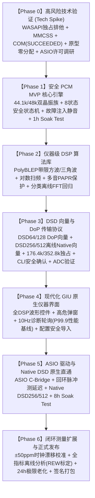
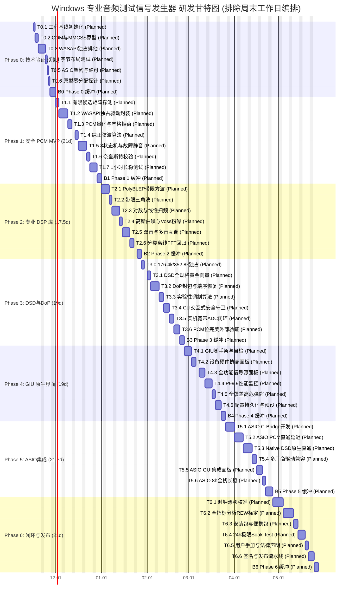

# Windows 专业音频测试信号发生器
## 分阶段开发进度安排表 v2.2 (Development Schedule & Task Breakdown)

---

## 1. 制定原则、工期假设与工具链基线

### 1.1 研发资源与工期计算模型
* **研发模式**：单人全栈研发（音频核心算法 + Windows 系统级驱动封装 + 桌面 UI）。
* **工作日与排程口径**：
  * 按标准工作日（周一至周五，排除法定节假日）测算，日历排程在甘特图中显式配置 `excludes weekends`。
  * **工期与缓冲配比**：
    * **纯净研发工期（Net Dev Days）**：**110.5 工作日**。
    * **显式工程缓冲（Explicit Buffer, 约 16.3%）**：**18 工作日**（分布在各阶段末期用于硬件适配、时钟校准与返工）。
    * **总预算工期（Total Budget Days）**：**128.5 工作日**。
    * 上述数字以任务表逐项求和为唯一口径；甘特图阶段标题和任务持续时间必须与之保持一致。
* **状态跟踪标准**：
  * **计划状态 (Planned Status)**：`Planned`（已排期）/ `Suspended`（暂停）。
  * **实际状态 (Actual Status)**：`未开始` / `进行中` / `已完成` / `阻塞`。
  * 项目初始状态全项为【未开始】，绝不使用虚假进度代替真实记录。

### 1.2 工具链与运行时版本锁定
* **Go 语言运行时**：项目初始化时锁定到 **Go 1.27.x 的具体补丁版本**，同时在 go.mod/toolchain 与 CI 中保持一致。
* **GUI 框架基线**：采用 **AllenDang/giu**；T0.1 必须在 go.mod 中记录实际使用的精确版本，不使用无上限的浮动依赖。
* **UI 运行时策略**：
  * 使用 Go 原生 GIU/OpenGL 渲染，不依赖 WebView2 或浏览器运行时。
  * 主程序直接创建原生桌面窗口，减少外部运行时前置条件。
  * 发布阶段（Phase 6）：构建标准安装包及免安装便携包。

---

## 2. 总体研发里程碑 (Roadmap Overview)

---

## 3. 各阶段任务详细分解与量化验收标准

### Phase 0：高风险技术验证（Tech Spike）
> **阶段目标**：验证 Go 运行时、Windows COM、WASAPI 独占打开与互斥拦截、MMCSS 优先级、OS 线程绑定的可行性；完成原型热路径零分配检验及 ASIO 许可与 ABI 调研。

| 任务 ID | 任务名称 | 责任文件 / 模块 | 计划状态 | 实际状态 | 工期(天) | 交付产物与量化验收指标 |
| :--- | :--- | :--- | :---: | :---: | :---: | :--- |
| **T0.1** | 工程基线初始化 | `go.mod`, 目录骨架 | Planned | 未开始 | 1 | 初始化并锁定 Go 1.27.x 与 GIU 精确版本；建立 `internal/` 规范目录骨架；配置 `golangci-lint`。验收：在本机与 CI 中执行 `go build ./...`、`go test ./...` 均干净通过，依赖解析结果一致。 |
| **T0.2** | COM & MMCSS 原型探针 | `cmd/spike/com_mmcss_test.go` | Planned | 未开始 | 1.5 | 验证固定 goroutine 绑定。验收：调用 `CoInitializeEx` 满足 `SUCCEEDED(hr)`（兼容 `S_OK` 与 `S_FALSE`，拒绝 `RPC_E_CHANGED_MODE`）；`AvSetMmThreadCharacteristicsW("Pro Audio", &taskIndex)` 返回非空句柄且 `taskIndex != 0`；退出前严格配对 `CoUninitialize`。 |
| **T0.3** | WASAPI 独占与排他性验证 | `cmd/spike/wasapi_spike.go` | Planned | 未开始 | 2.5 | 请求 `AUDCLNT_SHAREMODE_EXCLUSIVE` 打开默认设备并进入事件驱动推流循环。验收： 1. 独占打开成功，写入静音帧无卡顿； 2. 保持独占期间，由辅助进程尝试打开同一设备独占流，严格拦截并返回 `AUDCLNT_E_DEVICE_IN_USE`。 |
| **T0.4** | 字节布局与端序测试 | `cmd/spike/pcm_layout_test.go` | Planned | 未开始 | 1 | 编写 16-bit、24-bit (packed 3-byte) 及 24-in-32 (小端对齐) 的内存布局测试。验收：通过预置已知序列与内存字节切片进行 `bytes.Equal` 逐字节比对，100% 一致。 |
| **T0.5** | ASIO 架构与许可调研 | `docs/asio-feasibility.md` | Planned | 未开始 | 1 | 调研 Steinberg ASIO SDK 许可协议边界，确定 CGO 隔离方案与 32/64 位驱动兼容方案。验收：**输出签署合规备忘录与 C-Bridge 接口原型定义，作为 Gate 0 准出必备依据**。 |
| **T0.6** | 原型热路径内存分配探针 | `cmd/spike/alloc_spike_test.go` | Planned | 未开始 | 1 | 对原型推流回调进行基准测试。验收：使用 `testing.AllocsPerRun(1000, fn)` 验证在模拟渲染循环内内存分配数严格为 `0`。 |
| **B0** | Phase 0 技术缓冲 | - | Planned | 未开始 | 1.5 | 用于驱动兼容性异常排查与环境调整。 |

---

### Phase 1：安全 PCM MVP 核心引擎
> **阶段目标**：建立支持 44.1k/48k 双晶振族采样率的设备探测、WASAPI 独占驱动封装、8 状态安全生命周期状态机、防削波守卫、纯正弦发生器与 1 小时长稳测试。

| 任务 ID | 任务名称 | 责任文件 / 模块 | 计划状态 | 实际状态 | 工期(天) | 交付产物与量化验收指标 |
| :--- | :--- | :--- | :---: | :---: | :---: | :--- |
| **T1.1** | 有限候选矩阵能力探测 | `internal/audio/backend.go` `internal/audio/device.go` `internal/audio/capability.go` | Planned | 已完成 | 2 | 抽象 `AudioBackend` 接口；定义有限候选采样率矩阵 $\{44.1, 48, 88.2, 96, 176.4, 192\}\text{ kHz}$ 与格式矩阵 $\{16\text{I}, 24\text{P}, 24\text{in}32, 32\text{F}\}$。验收：逐项调用 `IsFormatSupported` 准确归类并返回 `Supported`、`Unsupported`、`DeviceBusy`、`DriverError`。 |
| **T1.2** | WASAPI 独占驱动封装 | `internal/audio/wasapi/backend_windows.go` `internal/audio/wasapi/stream_windows.go` `internal/audio/wasapi/com_windows.go` | Planned | 已完成 | 3.5 | 封装 COM 调用、事件驱动音频流（Event-driven IAudioClient）与缓冲区提交；对有限候选格式逐项精确探测并打开，禁止自动格式回退或隐式重采样。验收：**完整支持 44.1k/48k/88.2k/96k/176.4k/192kHz** 中硬件明确支持的格式，底层 HRESULT 完整透传。 |
| **T1.3** | PCM 量化与严格拒荷守卫 | `internal/format/pcm.go` `internal/format/quantizer.go` `internal/format/channel.go` `internal/format/peak.go` | Planned | 已完成 | 2.5 | 零分配浮点到整数转换、小端编码与声道交织。**拒荷策略**：默认情况下预测峰值 $>0\text{ dBFS}$ 时直接拒绝启动并返回 `ErrPeakExceedsFullScale`，仅在显式启用的测试模式下允许饱和截断。验收：`testing.AllocsPerRun` 为 0，拒荷拦截率 100%。 |
| **T1.4** | 纯正弦波算法发生器 | `internal/dsp/generator.go` `internal/dsp/sine.go` | Planned | 已完成 | 2 | 基于双精度相位累加器的正弦波发生器。验收分为两部分： 1. **数值正确性**：与高精度参考实现逐样本比较，记录最大绝对误差、RMS 误差、幅度误差和 DC 偏置； 2. **频谱纯度**：在 $F_s = 192\text{kHz}$、$N = 131072$、基频落在整数 FFT bin 的相干采样条件下，HD2~HD9 必须低于 **-130 dBc**，并将 **-140 dBc** 作为优化目标。频率误差由相位步进解析值验证，不使用 FFT 分辨率推断微赫兹级误差。 |
| **T1.5** | 8 状态引擎调度与安全静音 | `internal/engine/state.go` `internal/engine/buffer.go` `internal/engine/fader.go` `internal/engine/diagnostics.go` `internal/engine/engine.go` | Planned | 已完成 | 4 | 实现白皮书规定的完整 8 状态机：`Closed`、`Probing`、`OpenMuted`、`Primed`、`Running`、`FadingOut`、`Recovering`、`Faulted`。实现可配置淡入淡出包络（5~20ms）。验收： 1. 状态迁移矩阵单元测试 100% 覆盖（含格式切换先 FadeOut、断连不自动恢复）； 2. 软件层注入错误后，在 1 个设备周期内进入静音状态； 3. 物理拔出 USB 设备后，从 backend 首次收到设备失效事件开始，目标在 50ms 内进入 `Faulted` 并停止提交新数据；COM/驱动资源释放允许异步完成，单独记录实际耗时且不得阻塞实时线程。 |
| **T1.6** | 控制中枢与奈奎斯特校验 | `internal/controller/controller.go` `internal/controller/validation.go` | Planned | 已完成 | 1.5 | 严格按数学公式 $F_s \ge f / 0.45$ 校验。验收：请求 60kHz 时，在 $\le 96\text{kHz}$ 采样率下严格拒绝并返回 `ErrFrequencyExceedsNyquistLimit`；在 $176.4\text{kHz}$ 与 $192\text{kHz}$ 下允许放行。 |
| **T1.7** | Phase 1 集成与 1 小时长稳验收 | `cmd/cli-mvp/main.go` | Planned | 已完成 | 2.5 | 命令行版验收套件。测试矩阵：1kHz（48k/96k/192k）、30kHz（96k/192k）、60kHz（严格限定在 176.4k/192k）。验收：**连续运行 1 小时 Soak Test**，原子 Underrun 计数器为 0，热路径零 GC 分配。 |
| **B1** | Phase 1 工程缓冲 | - | Planned | 未开始 | 3 | 用于声卡底层时钟切换异常与故障注入边界调试。 |

---

### Phase 2：专业 DSP 信号发生器与量化频谱验证
> **阶段目标**：补全所有高价值测试波形，使用 PolyBLEP 算法彻底压制方波/三角波混叠，建立按波形分类的离线自动化频谱分析验收基线。

| 任务 ID | 任务名称 | 责任文件 / 模块 | 计划状态 | 实际状态 | 工期(天) | 交付产物与量化验收指标 |
| :--- | :--- | :--- | :---: | :---: | :---: | :--- |
| **T2.1** | PolyBLEP 带限方波发生器 | `internal/dsp/polyblep_square.go` | Planned | 已完成 | 3 | PolyBLEP 多项式平滑残差修正算法实现。验收：在 $f/F_s \le 0.4$ 的测试矩阵下，折返到可听带内的奈奎斯特以上寄生混叠谐波被抑制至基波 **-60 dBc 以下**，DC 偏置 $< 10^{-6}$。 |
| **T2.2** | 带限三角波发生器 | `internal/dsp/polyblep_triangle.go` | Planned | 已完成 | 2 | 基于积分修正的带限三角波生成器。验收：测量 3、5、7、9 次谐波，衰减斜率满足 **$-12\text{ dB/oct} \pm 0.5\text{ dB}$**，寄生混叠分量 $<-70\text{ dBc}$。 |
| **T2.3** | 对数与线性扫频发生器 | `internal/dsp/sweep.go` | Planned | 已完成 | 2.5 | 支持 Log/Linear Chirp 扫频，内置起止端点汉宁窗淡化。验收：在去除首尾 10% 淡化区间的稳态时间内，瞬时频率误差 $< 0.1\%$；时域最大过冲峰值 $< 1.05 \times \text{目标幅值}$。 |
| **T2.4** | 高斯白噪与 Voss 粉噪 | `internal/dsp/noise.go` | Planned | 已完成 | 2 | 可复现 PRNG 种子的高斯白噪；Voss-McCartney 滤波粉红噪声。验收：采用 Welch PSD（50% 重叠，平均 $\ge 100$ 次），对 20Hz~20kHz 的 1/3 倍频程结果做最小二乘拟合并在 1kHz 归一化；目标斜率为 $-3\text{ dB/oct}$，拟合残差在中间有效频段内不超过 **$\pm 0.5\text{ dB}$**，边缘频段单独记录。 |
| **T2.5** | 双音与多音互调发生器 | `internal/dsp/multitone.go` | Planned | 已完成 | 3 | SMPTE (60Hz+7kHz, 4:1)、CCIF (19k+20kHz, 1:1) 及可配置多音信号，计算 Crest Factor 与 PAPR 并自动归一化。验收：明确输出数字缩放量（Scale Factor），理论峰值严格限制在满幅以内，杜绝多音相加截断。 |
| **T2.6** | 分类离线频谱自动化回归管线 | `test/dsp_fft_test.go` | Planned | 已完成 | 2.5 | 搭建分类型 FFT 频谱回归测试套件。验收： 1. 单音/方波/三角波：输出准确的 THD、THD+N、SFDR 与混叠抑制比； 2. 扫频：检验包络平坦度与频率线性度； 3. 噪声：输出 PSD 斜率偏差、Crest Factor 与偏度/峰度； 4. 多音：计算并验证多音底噪与互调产物分布。 |
| **B2** | Phase 2 算法缓冲 | - | Planned | 已完成 | 2.5 | 用于带限多项式边缘逼近与高阶多音频谱优化。 |

---

### Phase 3：DSD 向量与 DoP 传输协议
> **阶段目标**：增加 176.4k/352.8k 格式适配，实现 DSD64/128 的 dCS DoP v1.1 封装；同时准备 DSD256/512 离线 Native DSD 向量，但不宣称 Phase 3 支持对应 DoP 载波。建立 CLI 安全守卫、宽带 ADC 验证和 PCM 位完美证据链。

| 任务 ID | 任务名称 | 责任文件 / 模块 | 计划状态 | 实际状态 | 工期(天) | 交付产物与量化验收指标 |
| :--- | :--- | :--- | :---: | :---: | :---: | :--- |
| **T3.0** | 176.4k/352.8k 独占流适配 | `internal/audio/wasapi/dop_stream.go` | Planned | 已完成 | 2 | 针对 DoP 载波要求，在 WASAPI 独占驱动中打通 **176.4kHz (DSD64)** 与 **352.8kHz (DSD128)** 的缓冲区协商与硬件时钟锁定。验收：外接支持高采样率的声卡，能够成功稳定打开 176.4k 与 352.8k 独占流。 |
| **T3.1** | 全规格 DSD 黄金测试向量库 | `internal/dsd/types.go` `internal/dsd/vector.go` | Planned | 已完成 | 2 | 固化 DSD64/128/256/512 标称参数，内置离线生成的 1kHz 纯正弦 Golden Bitstream。每个向量必须记录参考生成工具、版本、调制参数、幅度、bit order、长度和 SHA-256。验收：DSD64/128 用于 Phase 3 DoP；DSD256/512 仅作为后续 Native DSD 离线向量，不宣称 Phase 3 已支持对应 DoP 载波。 |
| **T3.2** | DoP 格式封装与状态机恢复 | `internal/dsd/dop.go` | Planned | 已完成 | 3.5 | dCS DoP v1.1 实现：16-bit DSD payload + 8-bit `0x05`/`0xFA` 交替 marker。验收： 1. 测试 DSD bit order，并保证同一 PCM frame 的所有声道使用相同 marker； 2. 24-bit packed 小端字节布局固定为 `[DSD0, DSD1, Marker]`；24-valid-in-32 按有效位左对齐，布局固定为 `[Padding0, DSD0, DSD1, Marker]`； 3. 暂停、underrun 或设备重开时立即进入 `OpenMuted`，停止提交 DoP；显式恢复时重新预填缓冲并以 `0x05` 作为本实现的确定性起始 marker，随后严格交替。 |
| **T3.3** | 实验性 Sigma-Delta 调制算法 | `internal/dsd/modulator.go` | Planned | 已完成 | 3 | 独立实现一阶/二阶 Sigma-Delta 调制算法，采用 3 天 timebox。结果不作为 Gate 3 通过条件，也不作为 DoP 默认数据源。验收以特性报告为主：分别记录两种拓扑的系数、稳定输入范围、状态峰值、DSD64 带内 SNR、最大 idle-tone spur 和 NTF 斜率；连续运行 10 分钟不得出现数值溢出。不得对一阶与二阶调制器使用统一的 100dB SNR 硬门槛。 |
| **T3.4** | CLI 交互式 DoP 安全守卫 | `internal/controller/dop_guard.go` | Planned | 已完成 | 1.5 | 落实安全准则（**Phase 3 阶段采用 CLI 交互提示**）：切换至 DoP 模式时必须展示警告：*“若 DAC 不支持 DoP，输出内容、频谱与电平不可预设，存在损伤听力与设备风险；测试前必须断开扬声器/耳机，或将后级放大器增益调至最低”*。要求显式输入 `YES` 或通过 `--confirm-dop-risk` 参数方可解锁。验收：未经确认前强制锁定于 `OpenMuted`。 |
| **T3.5** | 实机 DAC 宽带 ADC 闭环验收 | `test/dop_hardware_test.go` | Planned | 已完成 | 2.5 | 连接真实硬件验证。验收： 1. 目标 DSD DAC 点亮 DSD 指示灯； 2. 通过宽带 ADC 或数字捕获确认模拟基频为 1kHz，并记录幅度误差、THD、20Hz~20kHz 带内噪声及 20kHz 以上超声噪声谱；不得以“完全没有高频噪声”作为 DSD 正确性的标准； 3. 非 DSD 设备测试只验证默认保持静音，不执行未经确认的 DoP 推流。 |
| **T3.6** | PCM 位完美外部证据归档 | `test/bitperfect_hardware_test.go` `testdata/bitperfect/` | Planned | 已完成 | 2 | 通过至少一条可信数字捕获路径输出已知伪随机 PCM 序列并逐样本比较。验收：归档设备、驱动、请求/实际格式、源数据 SHA-256、捕获数据 SHA-256 和差异位置；只有通过该任务的组合才可在 UI 中标记为 `Verified`。 |
| **B3** | Phase 3 硬件联调缓冲 | - | Planned | 已完成 | 2.5 | 用于外接 USB DAC 握手延迟与 USB 传输抖动联调。 |

---

### Phase 4：现代化 GIU 原生仪器界面
> **阶段目标**：采用 GIU 构建专业暗黑工业仪器风原生 GUI，通过 UIService/Controller 分层保持低耦合，实现全功能控件暴露与 P99.9 渲染性能保障。

| 任务 ID | 任务名称 | 责任文件 / 模块 | 计划状态 | 实际状态 | 工期(天) | 交付产物与量化验收指标 |
| :--- | :--- | :--- | :---: | :---: | :---: | :--- |
| **T4.1** | GIU 原生界面脚手架与启动自检 | `cmd/app-giu/main.go` `internal/ui/giu/app.go` | Planned | 已完成 | 3 | 搭建 GIU 原生界面骨架，绑定 UIService 与 AppController。**启动自检**：初始化音频后端、设备监听和 UI 状态，确保失败时保持 OpenMuted。验收：Windows 10/11 环境下程序启动并在 2 秒内渲染出主界面。 |
| **T4.2** | 设备与硬件协商面板 | `internal/ui/giu/device_panel.go` | Planned | 已完成 | 2.5 | 声卡下拉选择、Exclusive 开关、展示实际协商打开的 SampleRate、BitDepth 与 BufferPeriod。验收：设备拔出/插入在 500ms 内触发 UI 状态更新并显示断连警告。 |
| **T4.3** | 全功能信号源控制仪表盘 | `internal/ui/giu/generator_panel.go` | Planned | 已完成 | 4 | **完整暴露所有已开发波形**：正弦、PolyBLEP 方波、PolyBLEP 三角波、扫频、高斯白噪、Voss 粉噪、多音/双音、DoP。提供双通道独立 dBFS 滑块。验收：参数调节响应流畅；非法输入（如超奈奎斯特频率）即时提示并禁用启动按钮。 |
| **T4.4** | 实时诊断与 P99.9 性能监控 | `internal/ui/giu/diagnostics_panel.go` | Planned | 已完成 | 3 | 10Hz 轮询展示状态机、Underrun、late callback、Render 执行耗时及位完美状态（Configured/Eligible/Verified/Unknown）。验收矩阵固定使用 10ms device period（48k/480、96k/960、192k/1920 frames），在记录了 CPU 型号、电源策略、压力工具和线程亲和性的参考机上运行 5 分钟：Render 执行耗时 P99.9 $<30\%$ BufferPeriod、最大值 $<70\%$ BufferPeriod、Underrun 为 0；唤醒迟到时间与 Render 用时分别统计。 |
| **T4.5** | 全覆盖高危操作安全弹窗 | `internal/ui/giu/app.go` | Planned | 已完成 | 2 | 针对超声波（$>20\text{kHz}$）、方波、多音高 Crest Factor 及 DoP 模式弹出强制警示，用户未手动确认前禁止解除静音。验收：弹窗拦截与“以后不再提示”持久化逻辑通过 Go UI 状态测试。 |
| **T4.6** | 配置持久化与安全预设导入 | `internal/controller/preset.go` | Planned | 已完成 | 1.5 | JSON 格式保存/加载测试配置。验收：加载保存的预设后，**输出状态严格维持在 OpenMuted**，绝不自动开启有声输出。 |
| **B4** | Phase 4 UI 联调缓冲 | - | Planned | 已完成 | 3 | 用于 GIU 原生控件、主题和暗黑仪器风 UI 细节打磨。 |

---

### Phase 5：ASIO 驱动与 Native DSD 原生直通
> **阶段目标**：通过 C-Bridge 接入 Windows ASIO 驱动接口，实现低延迟 PCM 直通，支持 Native DSD256（及硬件驱动允许的 DSD512 扩展），完成 8 小时 ASIO 长稳测试。

| 任务 ID | 任务名称 | 责任文件 / 模块 | 计划状态 | 实际状态 | 工期(天) | 交付产物与量化验收指标 |
| :--- | :--- | :--- | :---: | :---: | :---: | :--- |
| **T5.1** | ASIO C-Bridge 开发 | `internal/audio/asio/bridge/` | Planned | 已完成 | 4 | 使用 C/C++ 封装 Steinberg ASIO SDK，通过 CGO 桥接并严格隔离驱动回调与 Go 运行时调度。验收：成功枚举注册表中的 ASIO 驱动，完成 `ASIOInit` 与 `ASIOExit` 且无内存泄漏。 |
| **T5.2** | ASIO PCM 直通与延迟实测 | `internal/audio/asio/stream_windows.go` | Planned | 已完成 | 3.5 | 实现 `AudioBackend` 的 ASIO 版本。在 64/128/256-frame 缓冲下分别记录 `ASIOGetLatencies` 的输入/输出报告值、硬件回环实测往返延迟、固定转换器偏移和重复测量抖动。验收：固定配置重复 100 次时延迟测量标准差不超过 1 样本，连续推流 10 分钟零 Underrun；不把跨厂商“报告值与实测值差 1 样本”作为统一硬门槛。 |
| **T5.3** | Native DSD 原生直通 | `internal/audio/asio/dsd_stream.go` | Planned | 已完成 | 4 | 协商 ASIO DSD sample type，基准支持 **DSD256 (11.2896MHz)**，驱动允许时可选扩展 **DSD512 (22.5792MHz)**。ASIO 按通道提供独立缓冲，不按 PCM 方式交织；必须针对驱动报告的 `ASIOSTDSDInt8LSB1`、`ASIOSTDSDInt8MSB1` 或 `ASIOSTDSDInt8NER8` 分别实现逐通道 bit-order 转换和 Golden Vector 测试，无 DoP marker。 |
| **T5.4** | 多厂商驱动兼容性测试 | `test/asio_compat_test.go` | Planned | 已完成 | 3 | 使用明确记录版本的 Thesycon、Yamaha/Steinberg 等厂商驱动验证 PCM 与其实际支持的 Native DSD；ASIO4ALL 仅作为 WDM-to-ASIO PCM 兼容路径测试，不作为 Native DSD 证明。验收：驱动切换与重置无死锁、无进程 Crash，并输出设备/驱动/格式兼容矩阵。 |
| **T5.5** | ASIO 与 Native DSD GUI 集成 | `internal/ui/giu/device_panel.go` `internal/ui/giu/app.go` | Planned | 已完成 | 2 | 在 GIU 设备面板增加 ASIO 驱动控制（时钟源、sample type、Native DSD 模式与不可跳过的首次安全警告）。验收：所有参数经 Controller 校验后生效，绕过 UI 直接调用服务也不能跳过安全守卫。 |
| **T5.6** | ASIO 8 小时全栈长稳测试 | `test/asio_soak_test.go` | Planned | 已完成 | 2 | 在 T5.5 GUI 集成完成后，对最终 Phase 5 全栈执行 8 小时 ASIO 推流。验收：参考设备和固定 buffer 配置下 Underrun 为 0，Windows 句柄净增长为 0，内存及 goroutine 数量无持续单调增长。 |
| **B5** | Phase 5 驱动适配缓冲 | - | Planned | 已完成 | 3 | 用于处理各厂商 ASIO 专有驱动内部非标回调的兼容性补丁。 |

---

### Phase 6：闭环测量扩展与正式发布
> **阶段目标**：实现双时钟域 ppm 漂移校准采集回路，增加全指标离线 FFT 分析引擎（REW 标定），通过 24 小时极限 Soak Test，完成文档、签名与安装包发布。

| 任务 ID | 任务名称 | 责任文件 / 模块 | 计划状态 | 实际状态 | 工期(天) | 交付产物与量化验收指标 |
| :--- | :--- | :--- | :---: | :---: | :---: | :--- |
| **T6.1** | 采集回路与时钟漂移校准 | `internal/audio/capture_windows.go` `internal/analysis/sync.go` | Planned | 未开始 | 4.5 | 抽象音频录音采集端。**双时钟域算法验收指标**： 1. 起始延迟估计：通过 Chirp 互相关算法估计，延迟误差 $\le 2$ 样本； 2. **算法漂移估计精度**：在人工注入 $\pm 50\text{ ppm}$ 时钟偏差的验证集下，系统计算出的时钟漂移误差 $\le \pm 1\text{ ppm}$；校正后时间残差 $\le 0.1$ 样本。 |
| **T6.2** | 全指标分析与 REW 标定 | `internal/analysis/fft.go` `internal/analysis/thd.go` `internal/analysis/report.go` | Planned | 未开始 | 5 | 支持 THD、THD+N、SNR、IMD (SMPTE/CCIF)、通道串扰，支持导入麦克风/ADC 校准文件 (.cal/.txt)，支持导出 PDF/CSV 测试报告。**量化标定验收**：输入 24-bit 96kHz 标准参考 WAV，本系统与 REW 结果对比：THD+N 差异 $\le 0.2\text{ dB}$，频响差异 $\le 0.05\text{ dB}$。 |
| **T6.3** | 便携包与安装包发布构建 | `build/` | Planned | 未开始 | 3 | 编写 Inno Setup 脚本生成标准安装包，并打包免安装便携 zip。验收分为： 1. 全新 Windows 10/11 x64 环境：安装包能够完成安装并启动； 2. 无网络环境：已解压便携包可以直接启动； 3. 卸载器能够清理程序文件并保留用户数据。 |
| **T6.4** | 24 小时极限 Soak Test | `test/soak_24h_test.go` | Planned | 未开始 | 2.5 | 自动化 24 小时老化测试。预热 10 分钟后，每小时执行一次受控 GC 并采样活跃堆、goroutine、COM 对象和 OS 句柄；后 12 小时 retained heap 线性回归斜率目标 $<64\text{ KiB/hour}$，goroutine 与句柄净增长为 0，Underrun 为 0。不得用单次 `HeapAlloc` 差值或“0 bytes/hour”作为唯一泄漏证明。 |
| **T6.5** | 用户手册与第三方法律声明 | `docs/manual/` `LICENSE_THIRD_PARTY.md` | Planned | 未开始 | 2 | 编写完整用户使用手册、高危超声/方波安全操作指引；打包整理 Steinberg ASIO SDK 许可声明与开源第三方依赖声明。验收：文档齐备无遗漏。 |
| **T6.6** | 供应链、签名与发布流水线 | `scripts/release.ps1` `docs/release/` | Planned | 未开始 | 1.5 | 锁定 Go/GIU 依赖，生成 SBOM 与第三方许可证清单；使用 `SignTool` 和 RFC 3161 时间戳签名 exe、安装包及卸载器，生成 SHA-256 发布清单。验收：签名链验证通过，最终签名后的 installer/portable 制品重新执行安装、启动、卸载与基础音频 smoke test，并保存可回滚的发布制品和已知限制说明。 |
| **B6** | Phase 6 终审与发布缓冲 | - | Planned | 未开始 | 2.5 | 用于发布前全回归测试与未知 Bug 修复。 |

---

## 4. 关键依赖甘特图 (严格工作日排程：Excludes Weekends)

甘特图仅自动排除周末；项目所在地区的法定节假日必须在启动时以具体日期补充到 `excludes` 列表。以下阶段天数均包含对应 B0~B6 显式缓冲。

---

## 5. 准入与准出控制门禁 (Quality Gates)

每个阶段必须满足以下量化门禁条件方可签署流转至下一阶段：

* **Gate 0 (P0→P1)**：
  1. 真实物理设备成功完成 WASAPI 独占打开；
  2. 辅助测试进程请求独占时被成功拦截并返回 `AUDCLNT_E_DEVICE_IN_USE`；
  3. `runtime.LockOSThread` 下调用 `CoInitializeEx` 满足 `SUCCEEDED(hr)`，MMCSS 提升至 "Pro Audio" 返回有效任务句柄；
  4. 原型热路径回调通过 `testing.AllocsPerRun(1000, fn)` 验证，内存分配数严格为 0；
  5. **签署 ASIO SDK 许可备忘录，明确 CGO 隔离边界与 32/64 位 ABI 兼容方案**。
* **Gate 1 (P1→P2)**：
  1. 有限候选矩阵探测准确区分 `Supported`、`Unsupported`、`DeviceBusy`、`DriverError`；
  2. PCM 16/24/32-bit 黄金字节向量单测通过率 100%；
  3. 完整 8 状态机跃迁用例全绿；软件故障在 1 个设备周期内切换为静音；设备失效事件到达 backend 后目标在 50ms 内进入 `Faulted` 并停止提交新数据，驱动资源释放耗时单独记录；
  4. 纯正弦波在相干采样下 HD2~HD9 优于 -130 dBc，-140 dBc 作为优化目标；逐样本参考对比、幅度和频率误差满足设计边界；
  5. 连续 1 小时 Soak Test，原子 Underrun 计数为 0。
* **Gate 2 (P2→P3)**：
  1. PolyBLEP 带限方波在 $f/F_s \le 0.4$ 下混叠分量低于 -60 dBc，带限三角波谐波衰减率满足 $-12\text{ dB/oct} \pm 0.5\text{ dB}$；
  2. 扫频在稳态区间瞬时频率误差 $<0.1\%$，时域过冲 $<1.05$ 倍；
  3. 粉噪 Welch PSD 经 1kHz 归一化与最小二乘斜率拟合后，中间有效频段残差在 $\pm 0.5\text{ dB}$ 内；
  4. 多音 PAPR 归一化算法 100% 杜绝满幅溢出；
  5. 分类型离线 FFT 频谱回归测试套件全绿通过。
* **Gate 3 (P3→P4)**：
  1. WASAPI 独占驱动成功打通 176.4k 与 352.8k 格式流；
  2. DSD64/128 DoP 向量及 DSD256/512 离线 Native 向量均记录来源、参数与 SHA-256；24-bit packed、24-valid-in-32、bit order、同 frame 多声道 marker 一致性测试通过；
  3. DoP 经暂停、underrun 与重开后立即进入 `OpenMuted`，显式恢复时从确定性 marker 起点重新预填；
  4. 目标 DSD DAC 点亮 DSD 指示灯，并通过宽带 ADC 或数字捕获记录 1kHz 基频、幅度、带内噪声和超声噪声谱；
  5. PCM 已知伪随机序列通过可信数字捕获逐样本比较，证据归档完整；
  6. 未经 CLI 显式风险确认前，系统强制保持 OpenMuted 状态。
* **Gate 4 (P4→P5)**：
  1. 原生 GIU 界面在 Windows 10/11 x64 环境可稳定启动并完成设备初始化；
  2. 暴露全部已开发的波形控件与全覆盖高危确认弹窗；位完美状态能够显示 Configured、Eligible、Verified 和 Unknown；
  3. 在 50% CPU 负载压力下连续运行 5 分钟：**P99.9 分位数渲染延迟 $<30\%$ BufferPeriod，最大单次延迟 $<70\%$ BufferPeriod，Underrun 计数为 0**；
  4. 配置导入后默认处于 OpenMuted 状态。
* **Gate 5 (P5→P6)**：
  1. 厂商 ASIO 驱动完成 PCM 与其实际支持的 Native DSD 验证；ASIO4ALL 仅计入 PCM 兼容矩阵；
  2. 记录 `ASIOGetLatencies`、硬件回环实测延迟和重复测量抖动，固定配置下 100 次测量标准差不超过 1 样本；
  3. Native DSD 按驱动上报的 ASIO DSD sample type 使用独立声道缓冲并通过对应 bit-order Golden Vector；
  4. Native DSD 首次启用必须通过 Controller 级不可绕过的安全确认；
  5. GUI 集成后的最终 Phase 5 全栈连续运行 8 小时：Underrun 为 0、Windows 句柄净增长为 0、无持续单调内存增长。
* **Gate 6 (P6 发布门禁)**：
  1. 在人工注入 $\pm 50\text{ ppm}$ 偏差下，双时钟域漂移估计误差 $\le \pm 1\text{ ppm}$，校正后时间残差 $\le 0.1$ 样本；
  2. 标准基准 WAV 离线分析与 REW 对比误差：THD+N $\le 0.2\text{ dB}$，频响 $\le 0.05\text{ dB}$；
  3. 自动化 24 小时极限 Soak Test：受控 GC 后 retained heap 趋势满足阈值，goroutine 与句柄净增长为 0，零 Underrun；
  4. 标准安装包、免安装便携包与卸载流程在全新 Windows 10/11 x64 环境均通过；
  5. 用户手册、安全指引、SBOM、第三方许可和已知限制齐备；
  6. 最终 installer、portable exe 与卸载器均完成 RFC 3161 时间戳签名和 SHA-256 归档，签名后重新通过安装、启动、基础音频、卸载 smoke test。
