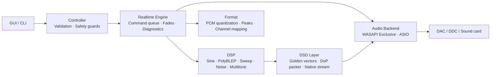

# 🎵 Pro Audio Lab · Sound Card Test Signal Generator

**English** | [简体中文](README.zh-CN.md)

### Windows Audio Hardware Acceptance and Test Signal Source (GUI + CLI)

[](https://github.com/lee-alone/Sound-Card-Test-Waveform-Generator)
[](https://github.com/lee-alone/Sound-Card-Test-Waveform-Generator)
[](https://github.com/lee-alone/Sound-Card-Test-Waveform-Generator)
[](https://github.com/lee-alone/Sound-Card-Test-Waveform-Generator)
[](LICENSE)

> Most signal generators stop at "play a sine wave." This project focuses on three harder questions:  
> **Was the signal altered by Windows, can the hardware chain run reliably, and does it fail safely when something goes wrong?**

It is a Windows test signal source for sound cards, USB DACs, digital interfaces, and headphone amplifiers. A single executable provides both a native GUI and a command-line mode, with support for high-rate PCM, DoP, ASIO Native DSD, channel fault isolation, XRun diagnostics, and automated soak testing.

---

## Why another signal generator?

The hard part is rarely generating a 1 kHz sine wave. The real challenge is reproducing the conditions that matter:

- Whether the application sample rate matches the device sample rate, with no hidden resampling in between;
- Whether system volume, APOs, effects, or format conversion are silently modifying samples;
- Whether 192 kHz, 352.8 kHz, 384 kHz, and DSD paths are actually accepted by the hardware;
- Whether the device drops out, leaks audio, or misroutes channels when only the left or right channel is active;
- Whether underruns, pops, or clock-lock problems appear during long runs;
- Whether you can tell afterward what was tested and whether it ran reliably.

The differentiator is not a longer spec sheet. It is bringing these pieces into a single observable, repeatable, and automatable test chain.

### Six capabilities that matter most

| Capability | Why it matters |
| :--- | :--- |
| **One executable, GUI + CLI** | Use the GUI for manual inspection and the CLI for bench scripts, production checks, and soak tests without maintaining two separate tools. |
| **WASAPI Exclusive + ASIO backends** | Provides explicit paths for low-interference PCM output and vendor ASIO drivers, while exposing requested and actual formats. |
| **PCM and DSD test paths in one tool** | PCM up to 384 kHz; DoP for DSD64/128; ASIO Native DSD for DSD256/DSD512, subject to driver and hardware support. |
| **Left/right channel fault isolation** | Stereo, Mono Sum, Invert R 180°, Solo L, and Solo R modes help isolate crosstalk, polarity errors, level imbalance, and single-channel firmware issues. |
| **Real-time performance telemetry** | The GUI reports underruns, late callbacks, peak render time, P99.9 callback load, peak levels, and Bit-Perfect status. |
| **Test-oriented safety controls** | Nyquist guards, sample-accurate fades, fail-safe muting, and DoP/Native DSD confirmation reduce the risks of high-frequency, multitone, and DSD testing. |

> Most audio players and basic signal generators cover only part of this workflow. The value here is the **combination**: test signals, hardware paths, safety controls, diagnostic data, and automation in one application.

---

## Scope and limitations

> [!IMPORTANT]
> This is a **test signal source**, not a standalone THD+N analyzer. It can provide the stimulus for a closed-loop measurement chain using Audio Precision, QA403, E1DA Cosmos ADC, or a calibrated loopback interface, but it does not replace capture, calibration, and spectrum-analysis software.

Three other points are worth stating clearly:

- **A backend name alone does not guarantee Bit-Perfect output.** Bit-Perfect should only be considered eligible or verified when the requested and actual formats match, software gain is unity, playback is stable, and the verification conditions are satisfied.
- **The current GUI and capability probe cover PCM sample rates up to 384 kHz.** The project does not claim 705.6 kHz or 768 kHz PCM as a delivered capability.
- **High sample rates, DSD, and ASIO depend on the device and driver.** The application submits the request and reports the actual result; it does not disguise unsupported hardware as a passing test.

---

## Capability overview

| Category | Current implementation |
| :--- | :--- |
| **Operating system** | Windows 10 / 11 x64 |
| **Interface language** | English / Simplified Chinese; follows the Windows UI language on first launch, can be switched from the top bar, and is saved locally |
| **PCM sample rates** | 44.1, 48, 88.2, 96, 176.4, 192, 352.8, and 384 kHz |
| **PCM sample formats** | 16-bit Int, 24-bit Packed, 24-in-32, and 32-bit Float |
| **Audio backends** | WASAPI Exclusive; ASIO 2.0+ with the device vendor's driver installed |
| **DSD over PCM** | dCS DoP v1.1: DSD64 over a 176.4 kHz carrier; DSD128 over a 352.8 kHz carrier |
| **Native DSD** | ASIO path for DSD256 and DSD512, subject to the capability reported by the driver and hardware |
| **Test waveforms** | Sine, PolyBLEP square, PolyBLEP triangle, linear sweep, logarithmic sweep, Gaussian white noise, pink noise, SMPTE intermodulation, CCIF intermodulation, and DoP carrier |
| **Signal controls** | Independent left/right levels from -144 to 0 dBFS, master trim, and a 0.45 × Fs frequency guard |
| **Channel modes** | Stereo, Mono Sum, Invert R 180°, Solo L, and Solo R |
| **Measurement presets** | 1 kHz/0 dBFS, 1 kHz/-1 dBFS, 1 kHz/-60 dBFS, 20 Hz–20 kHz sweep, SMPTE, CCIF, and CMRR differential phase |
| **Real-time display** | Waveform preview, dual-channel peak meters, underruns, late callbacks, render time, P99.9 load, and Bit-Perfect status |
| **Automation** | CLI support for device enumeration, format probing, parameterized sine output, soak testing, and guarded DoP startup |

### Implementation details that affect test quality

- **Sine generation** uses a float64 phase accumulator and does not rely on the Windows audio engine for format conversion.
- **Square and triangle waves** use PolyBLEP / PolyBLAMP edge correction with 2× oversampling and a 47-tap half-band decimator to suppress image folding.
- **Linear and logarithmic sweeps** use a Hann-window taper at the endpoints to reduce start/stop transients; single-shot and looped playback are supported.
- **White and pink noise** use explicitly seeded pseudo-random sequences so a test condition can be reproduced.
- **Multitone tests** include standard SMPTE and CCIF combinations with peak normalization to prevent digital clipping.
- **DSD test vectors** include DSD64/128/256/512 golden vectors with length, modulation parameters, bit order, and SHA-256 integrity metadata.

---

## Quick start

### Option 1: Run a release build

Download the Windows x64 executable from [Releases](https://github.com/lee-alone/Sound-Card-Test-Waveform-Generator/releases), then launch it:

```text
sound-signal-generator.exe
```

With no arguments, the application opens the GUI. Any command-line argument switches to CLI mode.

### Option 2: Build from source

Requirements:

- Go **1.27.4+**
- MinGW-w64 with `gcc.exe` and `windres.exe` for the ASIO CGO bridge and Windows resource compilation

```powershell
powershell -ExecutionPolicy Bypass -File scripts\build.ps1
```

The build script:

1. Compiles the Windows icon and version resources when `windres.exe` is available;
2. Builds the unified entry point in `cmd/app-giu`;
3. Produces a single executable at `bin/sound-signal-generator.exe`.

```powershell
.\bin\sound-signal-generator.exe
```

### CLI examples

```powershell
# List available audio devices
.\bin\sound-signal-generator.exe -list

# Probe the sample-rate and bit-depth combinations accepted by a device
.\bin\sound-signal-generator.exe -device "USB DAC" -probe

# Output 1 kHz at -6 dBFS, 96 kHz, 24-bit packed, for 10 seconds
.\bin\sound-signal-generator.exe -device "USB DAC" -freq 1000 -level -6 -rate 96000 -format 24p -duration 10s

# Run the 1 kHz, 30 kHz, and 60 kHz automated soak-test matrix
.\bin\sound-signal-generator.exe -device "USB DAC" -soak -duration 30s

# Start a DoP DSD64 carrier; explicit risk confirmation is required on first use
.\bin\sound-signal-generator.exe -device "USB DAC" -dop -dsd 64 -confirm-dop-risk -duration 30s
```

> The CLI currently focuses on device enumeration, format probing, sine output, soak testing, and DoP. Sweeps, noise, square waves, multitone signals, and Native DSD are primarily exposed through the GUI.

---

## Five-minute hardware acceptance workflow

### 1. Check what the device actually supports

Use `-probe` or the GUI capability probe to inspect the sample rates and bit depths accepted by the device. Do not rely only on the retail box or the indicators on the DAC.

### 2. Check noise floor and channel isolation

Mute the output or set a very low level, then slowly raise the headphone or power amplifier volume while listening for hum, USB interference, and abnormal high-frequency noise. Switch between `Solo L` and `Solo R` to check for crosstalk, dropouts, and channel misrouting.

### 3. Check polarity and imaging

Play a 200 Hz–1 kHz sine wave and switch between Stereo, Mono Sum, and Invert R 180°. An obviously shifted low-frequency image, a hollow center image, or an inverted response is worth investigating at the wiring or device-mapping level.

### 4. Observe the reconstruction filter and transients

Connect an oscilloscope to the analog output of the DAC or headphone amplifier and use the PolyBLEP square wave to inspect rise time, overshoot, and ringing. Then use a sweep to check high-frequency roll-off, clipping, and abnormal steps.

### 5. Run ultrasonic and soak tests

At a sample rate supported by the device, output 30 kHz or 60 kHz and monitor underruns, late callbacks, and peak render load. Before any long test, reduce downstream gain and make sure the tweeter can handle the test energy.

> A single observation is not enough to declare a firmware defect. Record the device model, driver version, sample rate, format, channel mode, and underrun data so the result can be reproduced.

---

## How to read Bit-Perfect status

The application exposes Bit-Perfect as an explainable state instead of relying on an "exclusive mode" label:

| Status | Meaning |
| :--- | :--- |
| **Configured** | The requested format is configured, but the stream has not yet entered a stable running state. |
| **Eligible** | The format matches, the stream is on an exclusive path, and software gain is unity; the path meets the Bit-Perfect conditions. |
| **Verified** | Byte-level verification evidence exists for the corresponding format combination; this is stricter than Eligible. |
| **Unknown** | Shared mode, format mismatch, non-unity gain, or another condition is not satisfied. |

`Eligible` only means the software path meets the conditions. It does not prove the entire hardware chain. `Verified` requires an actual evidence record and should not be replaced by a driver name or a DAC indicator light. Performance results should likewise be tied to the CPU, power mode, and background-load environment in which they were measured.

---

## Typical use cases

| Use case | What you can do |
| :--- | :--- |
| **New-device and second-hand acceptance** | Probe formats and test noise, channel balance, crosstalk, mono operation, ultrasonic behavior, and long-run stability. |
| **USB interface and DAC firmware troubleshooting** | Use Solo L/R, DoP, high sample rates, and repeated runs to investigate channel mapping, buffering, and clock issues. |
| **DAC filter observation** | Use band-limited square waves and sweeps to inspect ringing, roll-off, overshoot, and reconstruction-filter behavior at the analog output. |
| **Closed-loop distortion testing** | Serve as a repeatable stimulus for Audio Precision, QA403, E1DA Cosmos ADC, and similar analysis chains. |
| **DSD path validation** | Inspect DoP markers, DoP carrier rates, ASIO Native DSD sample types, and golden-vector transmission. |
| **Development and automation** | Debug interactively in the GUI, then use the CLI for scripted regression, long playback, and performance records. |

---

## Architecture



Core constraints:

- The real-time render path does not allocate memory, write logs, or call the UI;
- No silent resampling is performed when the requested and actual sample rates differ;
- Device loss, underruns, format conflicts, and dangerous configurations prefer muting;
- The UI operates through the Controller and never writes directly to the real-time audio buffer;
- All high-rate, DSD, and ASIO capabilities are reported according to actual device feedback.

### Source layout

```text
.
├── cmd/app-giu/                 # Unified GUI + CLI entry point
├── internal/
│   ├── audio/                   # WASAPI / ASIO / capability probing / Bit-Perfect evidence
│   ├── controller/              # Domain control, validation, safety guards, DSD state
│   ├── dsd/                     # Golden vectors, DoP packing, Native DSD source
│   ├── dsp/                     # Sine, PolyBLEP, sweep, noise, multitone
│   ├── engine/                  # Real-time scheduling, fades, buffer pool, diagnostics
│   ├── format/                  # PCM quantization, peaks, channel handling
│   ├── ui/giu/                  # Dear ImGui native console
│   └── ui/assets/               # Embedded icon assets
├── scripts/build.ps1            # One-command Windows build
├── assets/icon/                 # Icon source files and Windows PE resources
└── test/                        # DSP, DoP, ASIO, soak, and hardware acceptance tests
```

---

## Safety notes

1. **Start at minimum gain.** High-frequency tones, multitone signals, sweeps, and near-0 dBFS square waves have high energy density. Reduce power-amplifier or headphone-amplifier gain before starting.
2. **Do not run ultrasonic signals at full scale for long periods.** Content above 20 kHz is inaudible but can still heat a tweeter.
3. **DoP is not PCM music.** If the DAC does not recognize the DoP markers correctly, stop immediately and do not audition the unknown carrier through headphones.
4. **Use Native DSD only with explicitly supported devices and drivers.** The first activation requires a risk confirmation; do not bypass the safety guard.
5. **Record the test conditions.** Device, driver version, sample rate, format, channel mode, buffer settings, and diagnostics are far more useful than "I heard a pop."

---

## Testing and documentation

```powershell
# Run the Go test suite
go test ./...

# Build the application
powershell -ExecutionPolicy Bypass -File scripts\build.ps1
```

The repository includes tests for:

- Spectral and aliasing behavior of sine and non-sine waveforms;
- Edge and band-limiting behavior of PolyBLEP square and triangle waves;
- Amplitude and peak constraints for sweeps, noise, and multitone signals;
- DoP markers, bit order, channel synchronization, and golden-vector integrity;
- State machine, fail-safe muting, gain fades, and parameter validation;
- WASAPI/ASIO backends, buffer behavior, P99.9 render load, and soak scenarios.

Tests involving real DACs, ASIO drivers, and hardware loopback depend on the device, driver version, and system configuration. Performance tests are especially sensitive to the CPU, power mode, and background load. When citing a "pass" result, include the test environment.

More design details are available in the Chinese documentation:

- [AUDIO_TEST_WHITEPAPER.md](AUDIO_TEST_WHITEPAPER.md): product boundaries, the Bit-Perfect contract, and DSP/DSD/realtime-engine design;
- [DEVELOPMENT_SCHEDULE.md](DEVELOPMENT_SCHEDULE.md): development phases, acceptance tasks, and test matrices.

---

## License

This project is released under the [MIT License](LICENSE). Issues, device-compatibility reports, and pull requests are welcome.

If this project helps you find a hardware problem, the most useful feedback is not simply "it works." Include the **device model, driver version, sample rate/format, reproduction steps, and diagnostic data**.