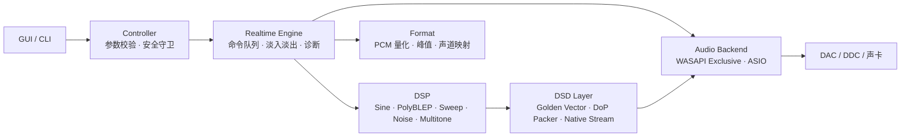

# 🎵 Pro Audio Lab · 声卡测试信号发生器

[English](README.md) | **简体中文**

### Windows 音频硬件验收与测试信号源（GUI + CLI）

[](https://github.com/lee-alone/Sound-Card-Test-Waveform-Generator)
[](https://github.com/lee-alone/Sound-Card-Test-Waveform-Generator)
[](https://github.com/lee-alone/Sound-Card-Test-Waveform-Generator)
[](https://github.com/lee-alone/Sound-Card-Test-Waveform-Generator)
[](LICENSE)

> 很多信号发生器只负责“放出一个正弦波”。这个项目更关心三件事：  
> **信号有没有被 Windows 改过、硬件链路能不能稳定跑完、出现问题时能不能安全停下。**

它是一款面向声卡、USB DAC、数字界面和耳放验收的 Windows 测试信号源。同一个可执行文件同时提供原生 GUI 与命令行模式，覆盖 PCM 高采样率、DoP、ASIO Native DSD、声道故障定位、XRun 诊断和自动化长稳测试。

---

## 为什么不是“又一个信号发生器”？

真正麻烦的往往不是生成 1 kHz 正弦波，而是下面这些测试条件能不能被复现：

- 应用采样率和设备实际采样率是否一致，中间有没有隐式重采样；
- 音量、APO、音效或格式转换有没有悄悄修改样本；
- 192 kHz、352.8 kHz、384 kHz 或 DSD 链路是否真的被硬件接受；
- 只播放左声道或右声道时，设备会不会断流、串音或错位；
- 长时间运行时有没有 underrun、爆音或时钟失锁；
- 测试结束后，能不能根据日志和状态判断“到底跑了什么、有没有跑稳”。

本项目的差异化不在于参数表比谁更长，而在于把这些环节放进同一条可观察、可重复、可自动化的测试链。

### 六个最值得强调的能力

| 能力 | 实际价值 |
| :--- | :--- |
| **同一 EXE 支持 GUI + CLI** | 手动验机时用图形界面；产线、脚本和长稳测试时直接走命令行，不需要维护两套工具。 |
| **WASAPI Exclusive + ASIO 双后端** | 为低干扰 PCM 输出和专业 ASIO 驱动提供明确路径，并显示请求格式与实际格式。 |
| **PCM 与 DSD 测试路径并存** | PCM 最高 384 kHz；DoP 支持 DSD64/128；ASIO Native DSD 支持 DSD256/DSD512（取决于驱动与硬件）。 |
| **左右声道故障定位** | 提供 Stereo、Mono Sum、Invert R 180°、Solo L、Solo R，适合排查串音、反相、偏音和单声道固件问题。 |
| **实时性能遥测** | GUI 显示 underrun、late callback、峰值渲染耗时、P99.9 回调负载、峰值电平与 Bit-Perfect 状态。 |
| **测试导向的安全设计** | 奈奎斯特防呆、样本级淡入淡出、失败静音、DoP/Native DSD 风险确认，降低高频、多音和 DSD 误操作风险。 |

> 同类音频播放器或简单信号发生器通常只覆盖其中一部分。这个项目强调的是**组合能力**：测试信号、硬件路径、安全控制、诊断数据和自动化入口同时存在。

---

## 先明确边界

> [!IMPORTANT]
> 这是一个**测试信号源**，不是独立的 THD+N 分析仪。它可以与 Audio Precision、QA403、E1DA Cosmos ADC、校准过的回环声卡等组成闭环测量链路，但本工具本身不替代采集、校准和频谱分析软件。

另外三点也值得明确：

- **Bit-Perfect 不是一个后端名称就能保证的结果。** 只有请求格式与实际格式一致、软件增益为 unity、播放处于稳定状态，并且满足验证条件时，才应称为 Bit-Perfect 候选或已验证路径。
- **当前 GUI 与能力探测覆盖的 PCM 采样率最高为 384 kHz。** 项目没有把 705.6 kHz / 768 kHz PCM 作为当前已交付能力宣传。
- **高采样率、DSD、ASIO 功能最终取决于设备与驱动。** 本工具负责发出请求并报告实际结果，不会把“设备不支持”伪装成“测试通过”。

---

## 能力总览

| 类别 | 当前实现 |
| :--- | :--- |
| **操作系统** | Windows 10 / 11 x64 |
| **界面语言** | English / 简体中文；首次启动跟随 Windows 界面语言，可在顶部栏切换，并保存到本机 |
| **PCM 采样率** | 44.1、48、88.2、96、176.4、192、352.8、384 kHz |
| **PCM 样本格式** | 16-bit Int、24-bit Packed、24-in-32、32-bit Float |
| **音频后端** | WASAPI Exclusive；ASIO 2.0+（需安装设备厂商驱动） |
| **DSD over PCM** | dCS DoP v1.1，DSD64 @ 176.4 kHz 载波；DSD128 @ 352.8 kHz 载波 |
| **Native DSD** | ASIO 路径，支持 DSD256 / DSD512（以驱动与硬件上报能力为准） |
| **测试波形** | 正弦、PolyBLEP 方波、PolyBLEP 三角波、线性扫频、对数扫频、高斯白噪声、粉红噪声、SMPTE 互调、CCIF 互调、DoP 载波 |
| **信号控制** | 独立左右声道电平（-144 至 0 dBFS）、主修调、频率限制在 0.45 × Fs 以内 |
| **声道模式** | Stereo、Mono Sum、Invert R 180°、Solo L、Solo R |
| **测量预设** | 1 kHz/0 dBFS、1 kHz/-1 dBFS、1 kHz/-60 dBFS、20 Hz–20 kHz 扫频、SMPTE、CCIF、CMRR 差分反相 |
| **实时显示** | 波形示波预览、双通道峰值表、underrun、late callback、渲染耗时、P99.9 负载、Bit-Perfect 状态 |
| **自动化** | CLI 支持设备枚举、格式探测、参数化正弦输出、Soak Test 和 DoP 安全启动 |

### 信号算法的几个实现细节

- **正弦波**使用 float64 相位累加，生成过程不依赖 Windows 音频引擎做格式转换。
- **方波 / 三角波**采用 PolyBLEP / PolyBLAMP 边缘修正，结合 2× 过采样和 47-tap 半带抽取滤波器，重点抑制非正弦波常见的镜像折叠。
- **线性 / 对数扫频**使用 Hann 窗渐变收尾，减少起止点瞬变；支持单次与循环播放。
- **白噪声 / 粉红噪声**使用带显式种子的伪随机序列，便于复现同一测试条件。
- **多音测试**内置 SMPTE 与 CCIF 标准组合，并执行峰值归一化，避免数字削波。
- **DSD 测试向量**内置 DSD64/128/256/512 Golden Vector，带有长度、调制参数、bit order 和 SHA-256 校验信息。

---

## 快速开始

### 方式一：直接运行发布版

从 [Releases](https://github.com/lee-alone/Sound-Card-Test-Waveform-Generator/releases) 下载 Windows x64 可执行文件，双击运行：

```text
sound-signal-generator.exe
```

不带参数时进入 GUI；传入任意命令行参数时进入 CLI 模式。

### 方式二：从源码构建

前置要求：

- Go **1.27.4+**
- MinGW-w64，提供 `gcc.exe` 与 `windres.exe`（ASIO CGO 桥与 Windows 资源编译需要）

```powershell
powershell -ExecutionPolicy Bypass -File scripts\build.ps1
```

构建脚本会：

1. 在 `windres.exe` 可用时编译 Windows 图标与版本资源；
2. 构建统一入口 `cmd/app-giu`；
3. 输出单一可执行文件到 `bin/sound-signal-generator.exe`。

```powershell
.\bin\sound-signal-generator.exe
```

### 命令行示例

```powershell
# 查看可用音频设备
.\bin\sound-signal-generator.exe -list

# 探测设备实际支持的采样率与位深组合
.\bin\sound-signal-generator.exe -device "USB DAC" -probe

# 输出 1 kHz、-6 dBFS、96 kHz、24-bit Packed，持续 10 秒
.\bin\sound-signal-generator.exe -device "USB DAC" -freq 1000 -level -6 -rate 96000 -format 24p -duration 10s

# 执行 1 kHz、30 kHz、60 kHz 自动化长稳测试矩阵
.\bin\sound-signal-generator.exe -device "USB DAC" -soak -duration 30s

# 启动 DoP DSD64 载波；首次使用必须显式确认风险
.\bin\sound-signal-generator.exe -device "USB DAC" -dop -dsd 64 -confirm-dop-risk -duration 30s
```

> CLI 当前主要覆盖设备枚举、格式探测、正弦输出、Soak Test 与 DoP。扫频、噪声、方波、多音和 Native DSD 的完整交互以 GUI 为主。

---

## 5 分钟收货验机流程

### 1. 先看“实际支持什么”

使用 `-probe` 或 GUI 的能力探测，检查设备真实接受的采样率和位深。不要只看包装盒或 DAC 面板上的灯。

### 2. 做底噪与声道隔离

将输出静音或设置到很低电平，慢慢提高耳放/功放音量，检查交流声、USB 干扰和异常高频噪声。随后切换 `Solo L`、`Solo R`，确认没有串音、断流或通道错位。

### 3. 查极性与结像

播放 200 Hz–1 kHz 正弦波，在 Stereo、Mono Sum 和 Invert R 180° 之间切换。低频结像明显偏移、中央声像发空或反相，通常值得继续检查接线与设备内部映射。

### 4. 做滤波器与瞬态观察

把示波器接在 DAC 或耳放模拟输出端，使用 PolyBLEP 方波观察上升沿、过冲和振铃。再配合扫频信号检查高频滚降、削顶和异常台阶。

### 5. 做超声与长稳压测

在设备支持的采样率下输出 30 kHz/60 kHz 信号，观察 underrun、late callback 和峰值渲染负载。长时间测试前务必降低后级增益，并确认高音单元能够承受测试能量。

> 单次现象不足以直接判定固件缺陷。建议记录设备型号、驱动版本、采样率、格式、声道模式和 underrun 数据，形成可复现的测试记录。

---

## Bit-Perfect 状态怎么看？

项目把 Bit-Perfect 拆成可解释的状态，而不是只显示一个“独占模式”标签：

| 状态 | 含义 |
| :--- | :--- |
| **Configured** | 请求格式已配置，但流尚未进入稳定运行状态。 |
| **Eligible** | 格式匹配、处于独占路径、软件增益为 unity，具备 Bit-Perfect 条件。 |
| **Verified** | 已有对应格式组合的字节级验证记录；这比 Eligible 更严格。 |
| **Unknown** | 共享模式、格式不匹配、非 unity 增益或状态不满足。 |

`Eligible` 只代表软件路径满足条件，不等于所有硬件链路都已证明。`Verified` 需要实际证据记录，不能用驱动名称或 DAC 指示灯代替。性能基准同样应对应明确的 CPU、电源模式和后台负载环境。

---

## 典型使用场景

| 场景 | 可以做什么 |
| :--- | :--- |
| **新机验收 / 二手交易** | 格式探测、底噪、偏音、串音、单声道、超声与长稳测试。 |
| **USB 界面 / DAC 固件排查** | 用 Solo L/R、DoP、高采样率和重复运行定位通道映射、缓存或时钟问题。 |
| **DAC 滤波器观察** | 用带限方波和扫频观察模拟输出的振铃、滚降、过冲与重建滤波器行为。 |
| **闭环失真测试** | 作为 Audio Precision、QA403、E1DA Cosmos ADC 等分析链路的可重复激励源。 |
| **DSD 链路验证** | 检查 DoP marker、DoP 载波、ASIO Native DSD sample type 和 Golden Vector 传输。 |
| **研发与自动化** | GUI 交互调试，CLI 做脚本化回归、长时间播放和性能记录。 |

---

## 架构



核心约束：

- 实时渲染热路径不分配内存、不写日志、不调用 UI；
- 请求采样率与实际采样率不一致时，不做静默重采样；
- 设备失效、underrun、格式冲突或危险配置优先进入静音；
- UI 通过 Controller 操作音频引擎，不直接读写实时缓冲区；
- 所有高采样率、DSD 和 ASIO 能力都以设备实际反馈为准。

### 源码结构

```text
.
├── cmd/app-giu/                 # GUI + CLI 统一入口
├── internal/
│   ├── audio/                   # WASAPI / ASIO / 能力探测 / Bit-Perfect 证据
│   ├── controller/              # 业务控制、参数校验、安全守卫、DSD 状态
│   ├── dsd/                     # Golden Vector、DoP 封装、Native DSD 源
│   ├── dsp/                     # 正弦、PolyBLEP、扫频、噪声、多音
│   ├── engine/                  # 实时调度、淡入淡出、缓冲池、诊断
│   ├── format/                  # PCM 量化、峰值与声道处理
│   ├── ui/giu/                  # Dear ImGui 原生控制台
│   └── ui/assets/               # 内嵌图标资源
├── scripts/build.ps1            # Windows 一键构建
├── assets/icon/                 # 图标源文件与 PE 资源
└── test/                        # DSP、DoP、ASIO、长稳与硬件验收测试
```

---

## 安全须知

1. **从最低增益开始。** 高频、多音、扫频和接近 0 dBFS 的方波能量密度很高，启动前请将功放或耳放增益调至最小。
2. **不要把超声信号长时间满幅输出。** 20 kHz 以上虽然听不见，但仍会驱动高音单元发热。
3. **DoP 不等于 PCM 音乐。** 如果 DAC 不能正确识别 DoP marker，应立即停止，不要用耳机试听未知载波。
4. **Native DSD 只应连接明确支持的设备与驱动。** 首次启用会要求显式风险确认，不要绕过安全守卫。
5. **记录测试条件。** 设备、驱动版本、采样率、格式、声道模式、buffer 和诊断数据，比一句“听起来有爆音”更有排查价值。

---

## 测试与文档

```powershell
# 运行 Go 测试
go test ./...

# 构建并检查
powershell -ExecutionPolicy Bypass -File scripts\build.ps1
```

仓库中的测试覆盖方向包括：

- 正弦与非正弦波形的频谱/混叠检查；
- PolyBLEP 方波与三角波的边沿和带限行为；
- 扫频、噪声、多音的幅度与峰值约束；
- DoP marker、bit order、声道同步和 Golden Vector 校验；
- 状态机、失败静音、增益淡入淡出和参数校验；
- WASAPI/ASIO 后端、缓冲区、P99.9 渲染负载与长稳场景。

需要注意：涉及真实 DAC、ASIO 驱动和硬件回环的测试，结果会随设备、驱动版本和系统配置变化。引用“通过”结论时，应同时记录测试环境。

更多设计细节见：

- [AUDIO_TEST_WHITEPAPER.md](AUDIO_TEST_WHITEPAPER.md)：产品边界、位完美契约、DSP/DSD/实时引擎设计；
- [DEVELOPMENT_SCHEDULE.md](DEVELOPMENT_SCHEDULE.md)：研发阶段、验收任务和测试矩阵。

---

## 开源许可证

本项目基于 [MIT License](LICENSE) 开源。欢迎提交 Issue、补充设备兼容性记录，或提交 Pull Request。

如果这个项目帮你发现了一个设备问题，最有价值的反馈不是一句“好用”，而是：**设备型号、驱动版本、采样率/格式、复现步骤和诊断数据**。